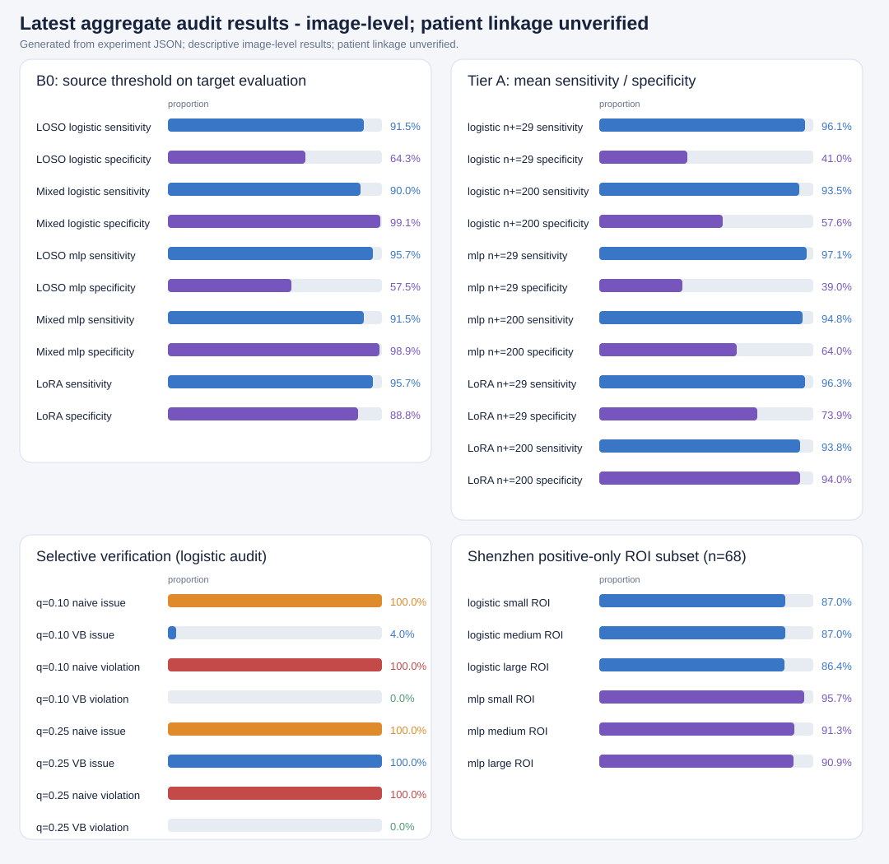

# Certify-or-Refuse Sensitivity Calibration for Chest X-Ray TB Triage

Source code and experiments for the research paper:

**Certify-or-Refuse Sensitivity Calibration for Chest X-Ray Tuberculosis Triage at New Sites: Class-Conditional PAC Certificates under Selective Verification**

## Overview

AI-based tuberculosis (TB) triage using chest X-rays (CXR) can fail when deployed at new sites because the target data distribution may differ from the training distribution.

This project investigates a **certify-or-refuse** framework for sensitivity calibration at new sites. The proposed approach focuses on three key components:

- **Class-conditional PAC guarantees:** Calibrate decision thresholds to provide Probably Approximately Correct (PAC) guarantees for minimum sensitivity on the target site, subject to specified statistical assumptions and confidence levels.
- **Certify-or-refuse decisions:** Refuse to issue a certificate when the available evidence is insufficient to establish the required sensitivity guarantee. Cases requiring further assessment can be referred for human review or additional diagnostic testing.
- **Selective verification and verification bias:** Study the implications of observing reference labels for only a selected subset of cases and develop calibration procedures for selective verification.

The project separates statistical calibration, model evaluation, and verification-policy calibration to support reproducible methodological experiments.

> **Research scope:** Experiments on public datasets provide methodological evidence, not clinical validation. Any PAC guarantee depends on its stated statistical assumptions and does not automatically establish clinical safety or generalization to arbitrary new sites.

> **Active manuscript file:** `paper/imrad.md` is the current working paper.
> The pre-existing JUTI Typst files are not updated by the current workflow;

## Datasets

The project uses the following datasets:

| Dataset    | Primary Location       | Description                                                                                   |
| ---------- | ---------------------- | --------------------------------------------------------------------------------------------- |
| Montgomery | `data/raw/montgomery/` | 138 CXR images, clinical readings, lung masks, and regions of interest (ROI).                 |
| Shenzhen   | `data/raw/shenzhen/`   | 662 CXR images, clinical readings, annotations, and ROI data.                                 |
| TBX11K     | `data/raw/TBX11K.zip`  | Approximately 3 GB; 8,400 training and validation images, read directly from the ZIP archive. |

**VinDr-CXR is not included in the current experiments** because access requires training or approval.

### Data Access and Usage

Dataset files are not included in this repository. Place the required data under `data/raw/` while preserving the directory structure specified above.

The NLM dataset documentation requests that the Montgomery and Shenzhen datasets not be redistributed outside the relevant research group or organization. Do not distribute raw data or derived datasets without reviewing the applicable source terms.

The TBX11K annotation manifest specifies the **CC BY-NC-SA 2.0** license. Preserve dataset attribution and review the applicable requirements before distributing derived materials.

### Download Datasets

Run this script on powershell for download it from source

```powershell
./download_dataset.ps1
```

### Dataset and Labeling Notes

- The inventory process reads the TBX11K ZIP archive without extracting the images.
- Only the official `TBX11K_train`, `TBX11K_val`, and `TBX11K_trainval` lists are used. Test labels are unavailable, and the `all_*` lists mix data from external sites.
- Montgomery and Shenzhen ROI CSV files contain positive-lesion annotations rather than complete image-level label inventories.
- Montgomery and Shenzhen labels are derived from the filename suffixes documented in the NLM README: `_0` indicates normal, while `_1` indicates abnormal/TB.
- Each image has a corresponding `ClinicalReading` with a matching filename stem.
- Each dataset image represents one unique patient, as documented in `data/README.md` and confirmed for all study datasets; image-based splits therefore preserve patient-level separation.
- For TBX11K, the primary positive-label definition requires at least one `ActiveTuberculosis` bounding box. Obsolete or ambiguous findings, as well as TB images without such boxes, are recorded separately rather than automatically classified as negative.

## Repository Structure

```Shell
tb-cxr-certified-sensitivity/
├── AGENTS.md                 # Contribution guidelines
├── CONTEXT.md                # Research protocol and context
├── TODO.md                   # Research roadmap
├── configs/                  # Data, method, and model configurations
├── data/
│   ├── raw/                  # Public source datasets (Git-ignored)
│   ├── processed/            # Preprocessed images and caches (Git-ignored)
│   └── splits/               # Site-specific split manifests
├── src/
│   └── tb_certify/
│       ├── data/             # Schemas, TBX11K catalog, preprocessing, splits
│       ├── models/           # Encoder provenance
│       ├── training/         # Source-site model heads
│       ├── calibration/      # Empirical thresholds and Tier A certificates
│       ├── verification/     # Selective verification policies and certificates
│       └── evaluation/       # Metrics and repeated Tier A studies
├── tests/                    # pytest tests
├── experiments/
│   └── runs/                 # Run configurations and results (not committed)
└── artifacts/
    ├── checkpoints/          # Model checkpoints
    └── embeddings/           # Extracted embeddings and provenance metadata
```

## Installation

Install [uv](https://docs.astral.sh/uv/), the Python package and project manager used by this repository.

Install the core dependencies:

```bash
uv sync
```

The statistical methods and dataset inspection utilities can run on a CPU. Optional vision encoders require a compatible PyTorch installation and, when applicable, a compatible CUDA environment.

To install the optional vision dependencies:

```bash
uv sync --extra vision
```

Run the test suite and the focused checks for the research runners:

```bash
uv run pytest
uv run ruff check scripts/run_lora_ablation.py scripts/render_result_thumbnails.py scripts/run_random_split_control.py scripts/analyze_lesion_size.py
```

Last recorded test snapshot: 8 passed on the existing suite (before this
reproducibility update; not rerun in this turn). Last focused Ruff run after
the new runners were added: all checks passed.

## Usage

### 1. Inspect and Preprocess the Data

Inspect the available datasets and generate the preprocessing outputs:

```bash
uv run tb-certify inspect-data --project-root .
uv run tb-certify preprocess-data --project-root .
```

The default 224-pixel image cache is used by ResNet50.

RAD-DINO uses a 518-pixel input size consistent with its model processor. Its dedicated cache must be generated directly from the source images:

```bash
uv run tb-certify preprocess-data \
  --project-root . \
  --output-dir data/processed/rad_dino_518 \
  --image-size 518
```

### 2. Prepare the RAD-DINO Checkpoint

Download the required RAD-DINO model files at the pinned revision:

```bash
uv run --extra vision hf download microsoft/rad-dino \
  config.json \
  preprocessor_config.json \
  model.safetensors \
  --revision 110cbc18d5133582e320b43d53bf5c44e410c936 \
  --local-dir artifacts/checkpoints/rad-dino-110cbc18
```

> if you want to just see on the web hugging face, open this https://huggingface.co/microsoft/rad-dino/tree/110cbc18d5133582e320b43d53bf5c44e410c936

### 3. Extract Frozen Embeddings

Extract embeddings using the general-purpose and chest-X-ray encoder configurations:

```Shell
uv run --extra vision tb-certify extract-embeddings \
  --project-root . \
  --encoder general

uv run --extra vision tb-certify extract-embeddings \
  --project-root . \
  --encoder chest_xray
```

Embedding extraction saves the following artifacts under `artifacts/embeddings/`:

- `embeddings.npy`
- A copy of the corresponding ordered manifest
- Model provenance metadata

Each run uses the model revision recorded in `configs/model.yaml`.

### 4. Run Calibration and Evaluation

The core statistical functionality is implemented in modules that do not require PyTorch.

#### Tier A: Class-Conditional PAC Calibration

`tb_certify.calibration.TierACalibrator` implements target-only, class-conditional PAC calibration.

When the number of positive calibration examples does not exceed the exact required floor, the procedure returns `REFUSE` rather than issuing a certificate.

#### Tier A: Evaluation

`tb_certify.evaluation.TierAStudy` summarizes:

- Sensitivity and specificity
- Certificate violations
- Refusal rates
- Clopper–Pearson confidence intervals on held-out data

#### Selective Verification

`tb_certify.verification.SelectiveVerificationCalibrator` implements an initial certification procedure for selective verification.

The threshold grid must be specified **before examining the confirmation labels** to avoid using those labels for threshold selection.

These modules provide the core functionality for studying calibration and verification policies. Refer to the repository configurations and tests for the currently implemented experimental settings.

## Reproducible Commands and Last-Run Evidence

Run commands from the repository root. Install the pinned project environment
once; the `vision` extra now includes the LoRA `peft` dependency.

```powershell
uv sync --extra vision
```

On a clean checkout, `uv` creates the project-local `.venv`. If using the
shared Windows environment in this workspace, set
`$env:UV_PROJECT_ENVIRONMENT = "C:\Users\abya\.venv"` before `uv sync` and
run commands inside that environment. The project lock file records the vision
and PEFT packages.

Last recorded environment: PyTorch 2.14.1+cu130, Transformers 4.57.6, PEFT
0.21.2, CUDA available. `nvidia-smi` last showed an idle NVIDIA GeForce RTX
3050 Laptop GPU with 6,144 MiB VRAM, driver 591.59 (driver CUDA 13.1).

### Data inventory and preprocessing

```powershell
uv run tb-certify inspect-data --project-root .
uv run tb-certify preprocess-data --project-root .
uv run tb-certify preprocess-data --project-root . --output-dir data/processed/rad_dino_518 --image-size 518
```

Last recorded inventory: Montgomery 138 images, Shenzhen 662, and TBX11K
train/validation binary cohort 8,260; preprocessing produced 9,060 images at
both requested resolutions with no decode failures. The 518-pixel cache hashes
are recorded in `artifacts/embeddings/chest_xray-110cbc18d513/metadata.json`.

### Checkpoint and frozen embeddings

```powershell
uv run --extra vision hf download microsoft/rad-dino config.json preprocessor_config.json model.safetensors --revision 110cbc18d5133582e320b43d53bf5c44e410c936 --local-dir artifacts/checkpoints/rad-dino-110cbc18
uv run --extra vision tb-certify extract-embeddings --project-root . --encoder general
uv run --extra vision tb-certify extract-embeddings --project-root . --encoder chest_xray
```

Last recorded embeddings: ResNet50-A1 `(9060, 2048)` and RAD-DINO `(9060, 768)`; the latter used CUDA FP16 inference, batch size 8, and a hash-verified
checkpoint. Provenance and embedding hashes are in each encoder's metadata
JSON under `artifacts/embeddings/`.

### Primary and secondary site-holdout studies

```powershell
uv run --extra vision python scripts/run_primary_real_study.py --project-root . --embedding-dir artifacts/embeddings/chest_xray-110cbc18d513 --output-dir experiments/runs/primary_tbx11k_loso/chest_xray-110cbc18d513 --target-site TBX11K --repetitions 1000 --seed 42
uv run --extra vision python scripts/run_primary_real_study.py --project-root . --embedding-dir artifacts/embeddings/chest_xray-110cbc18d513 --output-dir experiments/runs/secondary_shenzhen_loso/chest_xray-110cbc18d513 --target-site Shenzhen --repetitions 1000 --seed 42
```

Last recorded 
primary RAD-DINO B0: logistic 91.5% sensitivity / 64.3%
specificity; MLP 95.7% / 57.5%. 

Shenzhen last recorded 
B0: logistic 79.2% / 84.0%; 
MLP 77.4% / 89.6%. 

Result files are respectively
[`primary results`](experiments/runs/primary_tbx11k_loso/chest_xray-110cbc18d513/results.json)
and
[`Shenzhen results`](experiments/runs/secondary_shenzhen_loso/chest_xray-110cbc18d513/results.json).
All estimates are image-level observations with one image per patient, so the sample unit is patient-level; the results remain exploratory.

### Selective-verification audit

```powershell
uv run --extra vision python scripts/run_primary_real_study.py --project-root . --embedding-dir artifacts/embeddings/chest_xray-110cbc18d513 --output-dir experiments/runs/primary_tbx11k_loso/chest_xray-110cbc18d513/p0_8_selective --target-site TBX11K --repetitions 1000 --selective-repetitions 100 --seed 42
uv run --extra vision python scripts/run_primary_real_study.py --project-root . --embedding-dir artifacts/embeddings/chest_xray-110cbc18d513 --output-dir experiments/runs/primary_tbx11k_loso/chest_xray-110cbc18d513/p0_8_p1_linear_selective --target-site TBX11K --repetitions 1000 --selective-repetitions 100 --seed 42
```

Last recorded simulation: naive Tier A violation was 100% for both heads at
`q=0.10`; four-bound verification-bias certificates had 0 observed violations
among issued thresholds but issued in 4%/7% of runs. The linear IPW-Hoeffding
arm refused in all audited runs. Results are in the two `results.json` files
under `experiments/runs/primary_tbx11k_loso/chest_xray-110cbc18d513/`.

### Negative control and ROI analysis

```powershell
uv run --extra vision python scripts/run_random_split_control.py --project-root . --embedding-dir artifacts/embeddings/chest_xray-110cbc18d513 --output-dir experiments/runs/random_image_control/chest_xray-110cbc18d513 --repetitions 1000 --seed 42
uv run --extra vision python scripts/analyze_lesion_size.py --project-root . --embedding-dir artifacts/embeddings/chest_xray-110cbc18d513 --output experiments/runs/secondary_shenzhen_loso/chest_xray-110cbc18d513/p0_9_lesion_size/results.json
```

Last recorded random-split control: source-threshold specificity was 99.3%
(logistic) and 99.2% (MLP), versus 64.3% and 57.5% in the primary
leave-site-out evaluation. Last ROI run: 68 annotated Shenzhen positive
images; logistic sensitivity was 86.4–87.0% across size tertiles and MLP
sensitivity 90.9–95.7%. These are descriptive patient-level controls, not clinical severity claims. See
[`random split results`](experiments/runs/random_image_control/chest_xray-110cbc18d513/results.json)
and
[`ROI results`](experiments/runs/secondary_shenzhen_loso/chest_xray-110cbc18d513/p0_9_lesion_size/results.json).



Regenerate the thumbnail and workflow diagram from the JSON outputs:

```powershell
uv run --extra vision python scripts/render_result_thumbnails.py --output-dir paper/figures
```

Last preview command writes `paper/figures/latest_results.svg` and
`paper/figures/study_workflow.svg`; the latest-results SVG covers B0, Tier A,
LoRA, selective verification, and the positive-only ROI subset.

### Origin and pretraining-overlap audits

```powershell
uv run --extra vision hf download microsoft/rad-dino training_images.csv --revision 110cbc18d5133582e320b43d53bf5c44e410c936 --local-dir artifacts/audits/rad-dino-110cbc18
uv run --extra vision python scripts/probe_dataset_origin.py --embedding-dir artifacts/embeddings/chest_xray-110cbc18d513 --output experiments/runs/primary_tbx11k_loso/chest_xray-110cbc18d513/p0_4_origin_probe.json --seed 42 --folds 5
uv run --extra vision python scripts/audit_rad_dino_training_overlap.py artifacts/audits/rad-dino-110cbc18/training_images.csv artifacts/embeddings/chest_xray-110cbc18d513/manifest.csv --output artifacts/audits/rad_dino_training_overlap_110cbc18.json
```

Last recorded origin probe: 98.0% balanced accuracy (site information is
present; this does not establish causal shortcutting). Metadata overlap audit:
0 filename/ID matches across 882,775 upstream rows and 9,060 local images;
pixel-level duplicate checking remains unavailable. Keep the upstream
training-list and embedding manifest pinned to the revisions shown in the
command; changing either invalidates the recorded audit.

### LoRA ablation (optional, GPU required)

```powershell
uv run --extra vision python scripts/run_lora_ablation.py --project-root . --embedding-dir artifacts/embeddings/chest_xray-110cbc18d513 --output-dir experiments/runs/primary_tbx11k_loso/chest_xray-110cbc18d513/p1_2_lora_final --epochs 3 --batch-size 1 --gradient-accumulation 4 --repetitions 1000 --seed 42
```

This fits rank-8 LoRA adapters on RAD-DINO query/value projections using only
Montgomery and Shenzhen source training images, then audits against official
TBX11K train/validation pools. Last completed run: 3-epoch BCE
0.6013/0.2472/0.1222; B0 sensitivity/specificity 95.7%/88.8%; Tier A at 200
positives 93.8%/94.0%, empirical violation 1.2% (12/1,000; 95% CP interval
0.62–2.09%). The 6 GB RTX 3050 run completed without OOM. The output bundle
contains `results.json`, the LoRA adapter, `classifier_head.pt`, and source
split manifest `data/splits/lora_source_seed42.csv`.

Last-run evidence:
[`LoRA results`](experiments/runs/primary_tbx11k_loso/chest_xray-110cbc18d513/p1_2_lora_final/results.json),
[`adapter and head`](experiments/runs/primary_tbx11k_loso/chest_xray-110cbc18d513/p1_2_lora_final/),
[`split manifest`](data/splits/lora_source_seed42.csv).

### Code checks

```powershell
uv run pytest
uv run ruff check scripts/run_lora_ablation.py scripts/render_result_thumbnails.py scripts/run_random_split_control.py scripts/analyze_lesion_size.py
```

Last targeted lint check passed for the newly added random-split, lesion-size,
and LoRA scripts. The full historical suite previously passed 8 tests; rerun
these commands after a code change. No claim is made here about a new test run.

## Methodological Assumptions and Limitations

### Patient Identity and Data Leakage

One image per patient is confirmed for Montgomery, Shenzhen, and TBX11K (see `data/README.md`).

- Each of the three datasets contains one image per patient. The source manifest may leave the explicit `patient_id` column blank, but the one-to-one image-to-patient relationship is confirmed.

Consequently, splits based on image IDs are patient-level splits under the confirmed one-image-per-patient relationship.

### RAD-DINO Pretraining Audit

The RAD-DINO audit compared 882,775 pretrained image IDs/paths against the local dataset manifests and found no filename-based matches.

However, the audit cannot rule out renamed copies of the same images because the upstream inventory does not provide pixel-level hashes.

### Statistical Assumptions

The PAC interpretation assumes:

1. One score per patient, with observations independently and identically distributed (i.i.d.).
2. Accurate reference labels.
3. A fixed model during calibration and evaluation.
4. A stationary target population.

These assumptions are important to the interpretation of the statistical guarantees. The one-image-per-patient mapping establishes distinct patient units; representativeness, i.i.d. sampling, accurate labels, and stationarity remain assumptions.

Results should therefore be interpreted as methodological evidence under the stated assumptions, not as proof of clinical safety or validated performance at arbitrary deployment sites.

## Reproducibility
For the complete end-to-end commands, see [`docs/REPRODUCE.md`](docs/REPRODUCE.md).


The project uses the following practices to support reproducible experiments:

- **Configuration-based seeds:** Random seeds are recorded in configuration files.
- **Explicit split manifests:** Site-specific data splits are stored under `data/splits/`.
- **Run artifacts:** Experiment configurations and evaluation metrics are stored under `experiments/runs/`.
- **Pinned model revisions:** Encoder revisions are recorded in `configs/model.yaml`.
- **Automated tests:** Statistical and data-processing functionality is tested with `pytest`.

Keep Montgomery, Shenzhen, and TBX11K separate as distinct dataset sites when evaluating the new-site calibration setting. Mixing these sites during calibration could undermine the intended experimental design.

## Development Notes

The repository follows these implementation conventions:

| Component                       | Technology or Approach                            |
| ------------------------------- | ------------------------------------------------- |
| Dependency management           | `uv`, `pyproject.toml`, and `uv.lock`             |
| Deep learning                   | PyTorch, with a CUDA-compatible build when needed |
| Image transformations           | `torchvision`                                     |
| Model backbones                 | `timm`                                            |
| Parameter-efficient fine-tuning | `peft`                                            |
| Configuration                   | YAML with Pydantic validation                     |
| Statistical computation         | NumPy and SciPy                                   |
| Baseline metrics                | scikit-learn                                      |
| Experiment tracking             | CSV/JSON run records; MLflow is optional          |
| Testing                         | pytest                                            |
| Linting                         | Ruff                                              |
| Optional development tooling    | pre-commit                                        |

The `calibration/` and `verification/` modules should remain independent of PyTorch where practical. This allows statistical procedures to be tested quickly using synthetic scores and controlled test cases.

The TBX11K ZIP archive is read directly to avoid duplicating several gigabytes of image data.

## License and Data Governance

This repository does not include the source datasets.

Before using or redistributing any dataset, checkpoint, embedding, or derived artifact, review the applicable licenses, data-use conditions, and attribution requirements.

_Last Updated 22 October 2026_
