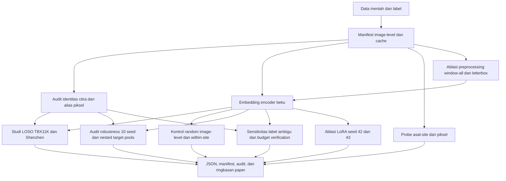

Workflow Research

Dokumen ini merangkum urutan eksperimen dan audit yang dipakai dalam penelitian. Perintah lengkap, parameter run, dan langkah reproduksi ada di [`REPRODUCE.md`](REPRODUCE.md).

**1. Collect Datasets** (`data/raw/`)
- Montgomery, Shenzhen (dengan ClinicalReadings, CXR_png, ManualMask/Annotations ganda, file ROI konsensus), dan TBX11K.zip
- `download_dataset.ps1` mengunduh TBX11K; Montgomery dan Shenzhen diperoleh terpisah dari distribusi NLM sesuai terms masing-masing.
- Label utama TBX11K positif adalah minimal satu box `ActiveTuberculosis`; 139 temuan obsolete dan 1 unresolved dikeluarkan dari kohort utama dan hanya masuk ke analisis sensitivitas label. Montgomery/Shenzhen memakai label abnormal pada clinical reading sebagai proxy radiologis, bukan konfirmasi mikrobiologis.

**2. Preprocessing & split** (`data/processed/`, `data/splits/`)
- Dua cache utama dipakai: `primary` (224x224) dan `rad_dino_518` (khusus resolusi 518 untuk RAD-DINO); masing-masing memiliki `manifest.csv`, `hash_audit.json`, dan `preprocessing.json` untuk traceability.
- Cache utama memuat 9.060 citra: Montgomery 138, Shenzhen 662, dan TBX11K 8.260; cache utama dan varian 518 menghasilkan citra RGB 224x224 dan 518x518 secara konsisten.
- Manifest dan seluruh split membagi rekaman pada tingkat citra; keterkaitan pasien belum diverifikasi sehingga pemisahan pasien tidak dapat diklaim. Skenario meliputi LOSO untuk target TBX11K dan Shenzhen, source split, random control, within-site control, serta split khusus LoRA. Seed dasar runner utama adalah 42, robustness memakai seed 42-51, dan LoRA memakai seed independen 42 dan 43.
- Cache ablation berada di `data/processed/ablation/`: global percentile windowing untuk semua citra (`window-all`) dan aspect-preserving letterbox, masing-masing pada 224 dan 518 piksel.

**3. Feature extraction / embedding** (`artifacts/embeddings/`)
- Dua encoder pralatih yang dibekukan (frozen): `chest_xray-110cbc18d513` (RAD-DINO, 518x518, CLS embedding 768 dimensi) dan `general-767268603ca0` (ResNet50-A1 ImageNet, pembanding)
- Embedding baseline berisi 9.060 baris masing-masing: RAD-DINO CLS 768 fitur dan ResNet50-A1 2.048 fitur; sidecar menyimpan revision, preprocessing, dan hash provenance.
- Encoder utama tidak di-fine-tune pada data TB dalam jalur eksperimen utama; checkpoint RAD-DINO disimpan dan diverifikasi hash-nya sebelum ekstraksi embedding
- Empat cache ablation dipasangkan dengan encoder yang sesuai: ResNet50-A1 pada `window-all-224` dan `letterbox-224`, RAD-DINO pada `window-all-518` dan `letterbox-518`; provenance cache dan embedding harus cocok sebelum hasil probe dibandingkan.

**4. Audit identitas citra dan duplikasi** (`artifacts/audits/image_identity.json`)
- `scripts/audit_image_identity.py` mencocokkan manifest dengan sumber gambar, menghitung hash piksel identik, menyaring kandidat perceptual hash, mengaudit duplikasi lintas site/split, dan membandingkan tetangga embedding secara aproksimasi. Jalankan dari root proyek dengan `uv run python scripts/audit_image_identity.py`.
- Audit menemukan 126 grup duplikat piksel identik di TBX11K (semuanya non-TB), 38 grup yang melintasi split resmi, tidak ada duplikat piksel identik lintas site, dan 18 kandidat perceptual hash lintas site. Kandidat perceptual/embedding perlu ditinjau; kandidat bukan identitas pasien atau bukti duplikasi pasti.
- Audit tidak memverifikasi crosswalk pasien; `patient_id` tetap kosong dan semua hasil downstream dilaporkan sebagai analisis image-level. Alias piksel dikeluarkan pada probe dan analisis yang memakai `--identity-audit`.

**5. Audit data leak dan asal-site** (`artifacts/audits/`)
- `audit_rad_dino_training_overlap.py` cek apakah data eval overlap dengan data training RAD-DINO (penting karena RAD-DINO model pretrained, bukan dilatih dari nol)
- Probe asal-site dari embedding dijalankan oleh `scripts/probe_dataset_origin.py:28-85`: mengambil embedding frozen dan label `site` dari manifest (`:30-42`), lalu memakai `StandardScaler` + balanced Logistic Regression (`:43-56`) dengan Stratified 5-fold cross-validation (`:57-60`). Ini mengukur informasi domain yang dapat dibaca dari embedding, bukan prediksi TB atau bukti penyebab shortcut. Hasil RAD-DINO alias-excluded tercatat di `experiments/runs/primary_tbx11k_loso/chest_xray-110cbc18d513/p0_4_origin_probe_deduped.json`: accuracy 0.9934 (99.3%), balanced accuracy 0.9860 (98.6%), dan macro OVR AUC 0.9992. Angka ini adalah metrik cross-validated asal-site, bukan metrik klasifikasi TB atau bukti shortcut kausal.
- Probe pembanding citra mentah dijalankan melalui `scripts/probe_pixel_site_features.py`; fitur ukuran/resolusi native, aspect ratio, dan ringkasan intensitas grayscale mencapai accuracy, balanced accuracy, dan macro OVR AUC 100% pada 8.934 citra setelah alias piksel dikeluarkan. Hasilnya ada di `experiments/runs/primary_tbx11k_loso/pixel_site_probe.json`; ini menunjukkan sinyal asal-dataset, bukan shortcut kausal.
- Empat probe embedding dari ablation preprocessing mengecualikan 126 alias piksel dan menghasilkan balanced accuracy 98,4% (ResNet50-A1 window-all-224), 98,7% (ResNet50-A1 letterbox-224), 98,3% (RAD-DINO window-all-518), dan 99,2% (RAD-DINO letterbox-518). Sinyal asal-site tetap mudah didekode setelah perubahan preprocessing; hasil ada di `experiments/runs/preprocessing_ablation/`.
- Audit metadata pretraining RAD-DINO membandingkan 882.775 baris `training_images.csv` dengan manifest lokal dan menemukan nol kecocokan image ID, stem, atau basename. Audit metadata ini tidak menyingkirkan duplikat piksel dengan nama berbeda karena gambar training upstream tidak tersedia.

**6. Training head, calibration, dan verification**
- **Encoder fitur:** RAD-DINO dan ResNet50-A1 ImageNet dibekukan pada studi utama; ekstraksi ada di `src/tb_certify/models/embeddings.py`. Fine-tuning RAD-DINO LoRA adalah ablation di `scripts/run_lora_ablation.py`.
- **Training head:** `src/tb_certify/training/source_head.py` melatih standardized Logistic Regression dari embedding data site sumber; MLP menjadi pembanding. Site target yang diuji dikecualikan dari training head. Ini classifier di atas embedding, bukan encoder.
- **Threshold baseline:** dipilih dari validasi source di `src/tb_certify/training/source_head.py` (`choose_source_threshold`); bersifat empiris, bukan sertifikat.
- **Kalibrasi ambang:** `src/tb_certify/calibration/source_threshold.py` menangani threshold empiris; `src/tb_certify/calibration/tier_a.py` mengimplementasikan Tier A; `src/tb_certify/calibration/risk_control.py` mengimplementasikan marginal CRC, W-CRC, dan IW-LTT. Runner melaporkan CRC dan IW-LTT berbobot satu serta mengukur performa pada holdout terpisah. W-CRC berbobot kalibrasi dan titik uji satu identik dengan CRC dan tidak ditampilkan sebagai hasil terpisah. Kisi IW-LTT ditetapkan dari kuantil skor validasi sumber, independen dari kalibrasi target. Bobot satu adalah baseline exchangeable, bukan koreksi pergeseran situs; shift nyata memerlukan rasio kepadatan positif dan batas bobot tervalidasi. Sertifikasi ini statistik (Clopper-Pearson/order statistic), bukan model machine learning.
- **Selective verification (certify-or-refuse):** `src/tb_certify/verification/selective.py` mengimplementasikan four-CP dan linear importance-weighted Hoeffding UCB. Bound IPW $V \cdot Y \cdot (\mathbb{1}\{\text{score} < t\} - \alpha)/\pi(\text{score})$ dihitung per threshold; threshold lolos berurutan jika UCB ≤ 0, jika tidak sertifikat menolak.
- **Evaluasi:** `src/tb_certify/evaluation/selective_study.py` menjalankan selective verification dan mengevaluasi threshold pada data terpisah; `src/tb_certify/evaluation/tier_a_study.py` menjalankan studi Tier A; `src/tb_certify/evaluation/binomial.py` menghitung interval Clopper-Pearson dan `src/tb_certify/evaluation/metrics.py` metrik threshold.
- **Provenance:** `src/tb_certify/models/provenance.py` menyimpan/memvalidasi asal model dan data; sidecar provenance embedding ditulis dari `src/tb_certify/models/embeddings.py`.

**7. Eksperimen** (`experiments/runs/`)
- **Alur umum run klasifikasi:** muat embedding frozen (RAD-DINO atau ResNet50-A1 sesuai run) dan manifest split; fit head Logistic Regression atau MLP pada data train; pilih threshold baseline dari validasi sumber untuk target sensitivitas 0.90; hitung metrik pada validasi dan evaluasi target. Pada LOSO, site target tidak masuk training head. Setiap eksperimen mencatat seed, ukuran cohort/split, metadata encoder, threshold, dan hasil per head di `results.json`.
- **`primary_tbx11k_loso`:** leave-one-site-out dengan TBX11K sebagai target dan site lain sebagai sumber. Dari target, protokol memisahkan data kalibrasi positif dan evaluasi; menjalankan baseline threshold empiris serta studi Tier A pada berbagai ukuran kalibrasi/repetisi. Untuk TBX11K juga ada negative controls (`healthy_only`, `healthy_plus_non_tb`). Selective verification eksploratori hanya dihitung jika `--selective-repetitions` diaktifkan (nilai default 0).
- **`secondary_shenzhen_loso`:** protokol leave-one-site-out serupa dengan Shenzhen sebagai target; head dilatih pada site sumber, lalu threshold baseline dan Tier A dievaluasi pada target. Hasil per head mencakup hitungan cohort, metrik baseline, dan keluaran Tier A.
- **`random_image_control`:** kontrol dengan pembagian acak tingkat gambar dan site tercampur; ini bukan split pasien karena linkage pasien tidak terverifikasi. Logistic Regression dan MLP dievaluasi pada split evaluasi; threshold berasal dari validasi, dan Tier A memakai split kalibrasi tersendiri. Tujuannya membandingkan dengan LOSO, bukan menguji transportabilitas lintas site.
- **Metrik threshold / confusion matrix:** untuk setiap threshold evaluasi, `src/tb_certify/evaluation/metrics.py` menghitung TP, FN, TN, FP, sensitivity, dan specificity. Komponen confusion matrix ini diserialisasi pada `results.json` sebagai `source_validation_metrics`, `target_b0_metrics` (atau `evaluation_b0_metrics` di kontrol random), dan metrik negative control jika berlaku. Pipeline belum membuat gambar atau tabel confusion matrix terpisah, dan metrik ini dihitung pada threshold yang ditentukan protokol.
- **Ablasi LoRA (`p1_2_lora`, `p1_2_lora_final`, `p1_2_lora_seed43`):** fine-tune RAD-DINO dengan LoRA sebagai pembanding terhadap encoder frozen, kemudian evaluasi classifier head pada TBX11K. B0 seed 42/43 adalah 95,7%/88,8% dan 95,1%/89,9%; Tier A n+=200 memiliki violation finite-pool 1,2% dan 17,7%. Ini hasil eksploratori image-level, bukan validasi atau penyangkalan PAC populasi.
- **Selective verification (`p0_8_selective`, `p0_8_p1_linear_selective`):** membandingkan Tier A naif, four-CP verification-bias certificate, dan linear IPW-Hoeffding certificate. Untuk linear IPW-Hoeffding ada run khusus di `experiments/runs/primary_tbx11k_loso/chest_xray-110cbc18d513/p0_8_p1_linear_selective/`. Keluaran utamanya adalah threshold yang lolos/ditolak, bound sertifikasi, dan perilaku refuse; ini bukan confusion matrix.
- **Analisis ukuran lesi (`p0_9_lesion_size`):** analisis sensitivitas threshold pada strata ukuran lesi subset gambar positif beranotasi ROI; ini analisis subgroup, bukan training model klasifikasi baru.
- Tiap kondisi run menyimpan hasil pada `results.json` di direktori run tersendiri. Artefak tambahan seperti split manifest atau metadata model dapat berada di sampingnya; ringkasan visual hasil, bila dibuat, merupakan langkah terpisah.

**8. Workflow audit dan sensitivitas tambahan**
- **Robustness multi-seed dan nested target pools:** `scripts/run_robustness_audits.py` menjalankan head pada seed 42-51 dan 1.000 split ulang yang memisahkan pool positif kalibrasi/evaluasi untuk TBX11K dan Shenzhen, lalu membandingkan Tier A/CRC pada grid ukuran sampel yang diperluas. Hasil ada di `experiments/runs/robustness_audits/`; violation finite-pool Tier A berkisar 4,7-6,7% pada n+=29 dan 2,9-6,9% pada n+=100. Ini stress test image-level pada pool terbatas, bukan validasi PAC populasi pasien.
- Workflow robustness yang sama menjalankan IW-LTT dengan 20 repetisi dan 10 ordering per sel, kontrol random within-site (`data/splits/within_site_random_control_seed42.csv`), serta simulasi null WSR 2.000 repetisi. WSR menolak 50/2.000 hipotesis null (2,5%; CP95 1,86-3,28%); domain odds/ESS lintas-site hanya diagnostik dan bukan rasio densitas tervalidasi untuk sertifikat berbobot.
- **Sensitivitas label ambigu:** `scripts/run_ambiguous_label_sensitivity.py` membandingkan pemetaan semua-positif dan semua-negatif untuk 140 record TBX11K obsolete/unresolved (139 obsolete, 1 unresolved; 104 train, 36 validation) pada kedua encoder. Setiap run memakai 1.000 repetisi dan mengecualikan 25 alias piksel identik dari evaluasi validasi; output ada di `experiments/runs/label_sensitivity/`. Ini analisis kebijakan label ekstrem, bukan penetapan kebenaran biologis atau klaim PAC.
- **Budget selective verification:** `scripts/run_selective_budget_sweep.py` menjalankan 100 repetisi pada 64 sel (N=1.000/2.000/4.000/6.496, prevalensi 0,05/0,10/0,20/0,40, q verifikasi skor rendah 0,10/0,25/0,50/1,00) dengan pool kalibrasi dan evaluasi bootstrap independen dari split train TBX11K yang dideduplikasi. Naif melanggar target empiris pada 2-100% sel; four-bound VB menerbitkan sertifikat pada 44/64 sel dengan 0-2% violation teramati di antara sertifikat; IPW-Hoeffding menerbitkan pada 9/64 sel tanpa violation teramati. Ini simulasi empiris, bukan jaminan populasi; hasil ada di `experiments/runs/primary_tbx11k_loso/chest_xray-110cbc18d513/p0_8_budget_sweep/results.json`.
- **LoRA seed independen:** selain run seed 42, `scripts/run_lora_ablation.py` dijalankan dengan seed 43 dan konfigurasi tiga epoch yang sama; B0 TBX11K adalah 95,1%/89,9%, sementara Tier A n+=200 memiliki rerata sensitivitas/spesifisitas 91,1%/94,5% dan 177/1.000 violation (17,7%; CP95 15,4-20,2%) dibanding 1,2% pada seed 42. Dua seed belum cukup untuk klaim robustness, dan hasilnya image-level finite-pool. Artefak ada di `experiments/runs/primary_tbx11k_loso/chest_xray-110cbc18d513/p1_2_lora_seed43/`, split sumber di `data/splits/lora_source_seed43.csv`.
- **Kontrol deduplikasi dan ROI:** kontrol random TBX11K yang mengecualikan alias disimpan di `experiments/runs/primary_tbx11k_loso/chest_xray-110cbc18d513/p0_6_random_split_deduped/`; kontrol within-site mempunyai manifest tersendiri. Analisis ROI Shenzhen merangkum 250 kotak pada 68 gambar positif, tetapi asal CSV relatif terhadap dua koleksi NLM belum terverifikasi; analisis ukuran lesi bersifat deskriptif, bukan ukuran keparahan klinis.
- Detail semua command, output directory, dan parameter re-run tersedia di bagian audit terkait dalam [`REPRODUCE.md`](REPRODUCE.md).

**9. Scripts orkestrasi** (`scripts/`)
- `scripts/run_primary_real_study.py` — menjalankan studi leave-site-out: melatih head dari site sumber, mengkalibrasi threshold, lalu mengevaluasi sertifikasi pada site target.
- `scripts/run_random_split_control.py` — menjalankan kontrol dengan split gambar acak yang mencampur site untuk membandingkan hasil saat distribution shift tidak dijaga.
- `scripts/run_lora_ablation.py` — fine-tune RAD-DINO dengan LoRA pada data sumber dan mengaudit performa head hasilnya pada TBX11K.
- `scripts/analyze_lesion_size.py` — menganalisis sensitivitas threshold menurut strata ukuran lesi pada subset gambar positif yang memiliki anotasi ROI.
- `scripts/probe_dataset_origin.py` — menguji seberapa akurat asal-site dapat diprediksi dari embedding frozen menggunakan cross-validation.

- Skrip audit tambahan: `scripts/audit_image_identity.py`, `scripts/probe_pixel_site_features.py`, `scripts/run_robustness_audits.py`, `scripts/run_ambiguous_label_sensitivity.py`, dan `scripts/run_selective_budget_sweep.py`.

**10. Pelaporan, tata kelola, dan penulisan paper** (`paper/`)
- `imrad.md` adalah draf aktif dan isinya disinkronkan ke `main.typ`; kompilasi Typst belum dilakukan karena executable dan template dependency yang dibutuhkan tidak tersedia di checkout ini.
- `literature_search.md` mencatat pencarian supplemental dan metadata rujukan; Scopus masih on hold dan Google Scholar tidak dapat diakses lewat antarmuka yang tersedia, sehingga tidak ada klaim tinjauan sistematis atau prioritas. `references.bib` memuat metadata sitasi yang telah dikoreksi.
- `data_governance.md` dan `reporting_checklist.md` mencatat batas distribusi, item STARD-AI, serta status etik/lisensi yang belum dikonfirmasi. Jangan rilis skor/embedding yang terkait citra sampai izin institusi dan hak distribusi jelas.
- Folder `SA-CTC for Tuberculosis/` berisi draf lama/paralel (termasuk `Literature Review.md` dan `Template - JUTI-OTH.docx`) yang kemungkinan dibuat sebelum pivot ke format IMRaD Typst; folder ini tidak diedit.

**11. Testing** (`tests/`)
- Unit test untuk modul kalibrasi/verifikasi, floor/order statistic, preprocessing, refusal, dan identity claims berada di `tests/`; pemeriksaan terakhir yang tercatat adalah 15 tes lulus dan Ruff lulus pada `src` serta `scripts`.

**Alur end-to-end:** inventaris dan label sumber → manifest image-level dan audit identitas → cache utama/ablation → embedding frozen dan audit overlap/origin → studi LOSO, random dan within-site controls, Tier A/CRC/IW-LTT, selective verification, label/budget/LoRA sensitivity → simpan JSON, split, metadata provenance → tulis IMRAD, daftar pustaka, data governance, dan reporting checklist.
