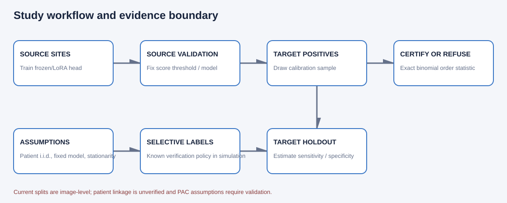

# Certify-or-Refuse Sensitivity Calibration for TB Chest Radiographs

**Working research manuscript (IMRAD).** This is the active manuscript file.
The JUTI Typst draft is not updated by this workflow. All real-data estimates
below are exploratory image-level results; no patient-level independence or
clinical validity is claimed.

## Abstract

**Background:** A chest-radiograph TB triage threshold chosen at a source site
may not retain sensitivity at a new site, and selective microbiological
confirmation can distort the observed positive calibration sample.

**Methods:** We implemented an exact class-conditional order-statistic
certificate for target sensitivity at least 90% with failure probability 5%,
which refuses below a 29-positive floor. Frozen RAD-DINO image features and
source-only logistic/MLP heads were evaluated on official TBX11K train and
validation pools. We audited a site-mixed image-random negative control, a
simulated selective-verification policy with Clopper--Pearson (CP) bounds and
an IPW--Hoeffding comparator, and lesion-size strata among 68 annotated
Shenzhen positives.

**Results:** At the source threshold, TBX11K validation sensitivity and
specificity were 91.5%/64.3% for logistic regression and 95.7%/57.5% for the
MLP with RAD-DINO; ResNet50-A1 reached 84.1%/33.3% and 88.4%/31.0%,
respectively. A source-only RAD-DINO LoRA ablation reached 95.7%/88.8% at its source
threshold. At $n^+=200$, its Tier A mean was 93.8%/94.0% (empirical
violation 1.2% across 1,000 resamples). The frozen-head Tier A means were
93.2%/58.8% and 94.5%/65.7%, respectively. The random-split control had 99.3%/99.2%
specificity at the source threshold (logistic/MLP), illustrating how a
site-mixed split can look easier than leave-site-out evaluation. Under
simulated low-score verification probability $q=0.10$, naive calibration
violated the empirical sensitivity target in 100% of 100 audit repetitions;
the four-bound certificate issued in 4%/7% of repetitions and had no observed
violations among issued thresholds. The linear IPW--Hoeffding arm always
refused. ROI-stratum sensitivities were imprecise and showed no clear
monotone lesion-size trend.

**Conclusion:** The implementation makes the exact sample-size refusal rule
explicit and demonstrates the utility cost of conservative selective-label
certification. All conclusions remain image-level and exploratory. Verified
patient linkage, external database screening, and data-use review remain
outstanding before a submission or artifact release.

## 1. Introduction

Computer-aided detection (CAD) scores from chest radiographs are used to
support TB screening and triage. A decision threshold that reaches a desired
sensitivity in a development cohort need not preserve that sensitivity in a
new site with different acquisition, population, or negative-disease spectrum.
In field screening, microbiological verification may also depend on symptoms,
score, or clinician judgment. If lower-scoring people are less likely to be
verified, the observed TB-positive sample is selected rather than representative.

Prior multi-site CXR evaluation has documented performance across distinct
populations, and an individual-participant diagnostic-accuracy meta-analysis
has examined threshold behavior across studies ([Qin et al., 2019](https://pubmed.ncbi.nlm.nih.gov/31628424/);
[Tavaziva et al., 2022](https://pubmed.ncbi.nlm.nih.gov/34286831/)). These
records motivate local evaluation; they do not establish novelty for the
procedure audited here. The literature search is exploratory, not systematic,
and Scopus remains explicitly on hold (see
[`literature_search.md`](literature_search.md)).

Risk-control comparators motivate finite-sample calibration and covariate-shift
corrections ([Bates et al., 2021](https://doi.org/10.1145/3478535);
[Zecchin et al., 2025](https://arxiv.org/abs/2501.11413);
[Almeida et al., 2025](https://proceedings.mlr.press/v266/almeida25a.html)).
The code includes CRC, weighted CRC, and importance-weighted LTT components,
but no validated positive-conditional density ratio and weight bound are
available for these real sites; those weighted baselines are therefore not
reported as real-data competitors. RAD-DINO is a self-supervised chest-X-ray
encoder ([Pérez-García et al., 2024](https://doi.org/10.1038/s42256-024-00965-w)).

This study investigates a certify-or-refuse workflow: calibrate a threshold
using target-site TB-positive scores and issue it only if an exact finite-
sample class-conditional sensitivity criterion is feasible. For selective
verification, we compare a conservative four-bound certificate and a linear
importance-weighted Hoeffding arm under a simulated known-probability policy.
We do not introduce a new theorem. The contribution is an implementation and
audit of the assumptions, refusal behavior, and empirical utility trade-offs.

Research questions are:

1. What sensitivity/specificity trade-off does the target-only exact rule show
   on an image-level target holdout?
2. How different is a site-mixed random image split from leave-site-out
   evaluation?
3. How do naive and conservative procedures behave when low-score reference
   verification is selective with known probability?
4. Do source-threshold sensitivities differ descriptively across the
   available positive-only lesion-size annotations?

## 2. Methods

### 2.1 Data sources, label policy, and units

The processed cohort contains 9,060 images: 138 Montgomery, 662 Shenzhen,
and 8,260 binary TBX11K records. Montgomery and Shenzhen image-level labels
follow their documented filename suffix convention. For TBX11K, active TB is
positive only when at least one `ActiveTuberculosis` annotation is present;
obsolete-only and unresolved TB records are excluded rather than labeled
negative. The official TBX11K training and validation lists are used; the
unlabeled test partition and mixed-site `all_*` lists are excluded.

The primary protocol trains on Montgomery and Shenzhen, calibrates on
TBX11K-train positives, and evaluates on TBX11K validation. The secondary
protocol holds Shenzhen out, trains on Montgomery and official TBX11K train,
and uses an image-stratified 50/50 Shenzhen calibration/evaluation split.
Montgomery/Shenzhen ROI CSVs annotate positive lesions only; they are not
complete label inventories. Image names and ROI `patientId` values are not
treated as verified patient identifiers. The sampling unit throughout is
therefore an image, and patient-level independence is unknown.

### 2.2 Encoders and source-only decision rules

We used frozen ImageNet ResNet50-A1 and RAD-DINO encoders with pinned
revisions. RAD-DINO used the 518-pixel processor and CLS-token embedding;
embeddings were extracted on CUDA with FP16 inference and stored as float32.
Logistic regression and a one-hidden-layer MLP (128 units) were fitted only
to source training images. A source validation set selected the empirical
threshold whose observed source-positive sensitivity reached 90%. This
source threshold is an empirical baseline, not a target-site certificate.

An origin probe used five-fold stratified cross-validation to predict site
from RAD-DINO embeddings. It diagnoses whether embeddings contain site
information; it cannot establish causal shortcut learning.

### 2.3 Exact Tier A certificate

Let $s(x)$ increase with evidence for active TB, and predict positive when
$s(x)\ge t$. For a target population $P_T$, the sensitivity estimand is

$$
\operatorname{Sens}_T(t)
= P_T\{s(X)\ge t\mid Y=1\}, \qquad
\operatorname{FNR}_T(t)=1-\operatorname{Sens}_T(t).
$$

The target FNR tolerance is $\alpha=0.10$ and the failure probability is
$\delta=0.05$. Given $n^+$ target-positive calibration scores
$S_1^+,\ldots,S_{n^+}^+$, define

$$
k^*(n^+)=\max\left\{k\in\{0,\ldots,n^+-1\}:
\Pr\bigl[\operatorname{Bin}(n^+,\alpha)\le k\bigr]\le\delta\right\}.
$$

If this set is empty, output **REFUSE**. Otherwise, with ascending order
statistics $S_{(1)}^+\le\cdots\le S_{(n^+)}^+$, set

$$
\widehat t=S_{(k^*(n^+)+1)}^+.
$$

Under representative i.i.d. target-positive calibration observations, a
fixed score/model, accurate reference labels, and stationarity between
calibration and use, the finite-sample statement is

$$
\Pr_{D_{\mathrm{cal}}}\!\left[
\operatorname{Sens}_T(\widehat t)\ge 1-\alpha
\right]\ge 1-\delta.
$$

For $k=0$, feasibility requires $(1-\alpha)^{n^+}\le\delta$, hence

$$
n^+_{\min}=\left\lceil\frac{\log\delta}{\log(1-\alpha)}\right\rceil=29.
$$

The guarantee concerns population sensitivity conditional on the assumptions;
it is not a per-patient guarantee. Because verified patient linkage is absent,
our real-data runs audit the algorithm and its holdout behavior but do not
validate this PAC interpretation for patients.

### 2.4 Selective-verification policy and certificates

For each fully labeled record in the TBX11K-train simulation, a fixed
reference score cutoff $c$ was used. All records with $s_i\ge c$ were
verified, while records below $c$ were independently verified with
probability $q$. Thus the known verification probability is

$$
\pi_i=\Pr(V_i=1\mid s_i)=
\begin{cases}1,&s_i\ge c,\\q,&s_i<c.\end{cases}
$$

The experiment hides unverified labels from the calibrators. The threshold
reference cutoff $c$ is the source-validation threshold. The candidate grid
contains unique source-validation score quantiles at 25 probability points
from 0.01 through 0.99, fixed before simulated verification labels are
examined. The audited low-score verification probabilities are
$q\in\{0.10,0.25,0.50,1.00\}$.

For the four-bound CP certificate, split $\delta$ into four tails
$\eta=\delta/4$. At candidate threshold $t$, bound high-score and low-score
miss counts above with CP upper bounds $U_H(t)$ and $U_L(t)$; scale the
low-score upper bound by $1/q$. Bound high- and low-score positive totals
below with CP lower bounds $L_H,L_L$, scaling the low-score term by $1/q$.
The implementation's FNR upper bound is

$$
U_{\mathrm{FNR}}(t)=
\frac{U_H(t)+U_L(t)/q}{L_H+L_L/q}.
$$

If the denominator lower bound is zero, the bound is infinite. A threshold
passes when $U_{\mathrm{FNR}}(t)\le\alpha$; a fixed-sequence rule issues the
largest threshold in the initial consecutive passing prefix, otherwise it
refuses. For misses below $c$, the implementation uses the lower segment
$(s_i<\min(t,c))$; all records at or above $c$ must be observed.

The linear arm tests a single IPW functional per fixed threshold. With
$Z_i(t)=V_iY_i(\mathbf1\{s_i<t\}-\alpha)/\pi_i$, it computes

$$
\overline Z(t)+
\sqrt{\frac{\log(1/\delta)\sum_{i=1}^N\pi_i^{-2}}{2N^2}},
$$

and passes if this upper bound is at most zero. The implementation stops at
the first failing threshold. This is the evaluated Hoeffding arm, not a
claim that it is uniformly tighter or empirically useful.

### 2.5 Controls, secondary analysis, and uncertainty summaries

The negative-spectrum control compares healthy-only negatives with healthy
plus non-TB disease negatives. The random-split negative control uses a
stratified image-level random split that allows each site to occur in model
training, calibration, validation, and evaluation; it is intentionally not
a transportability estimate and may retain within-patient dependence.

For lesion size, we matched the 250 Shenzhen ROI boxes to 68 active-TB
manifest images. Per image, size is maximum annotated bounding-box area
divided by the original full-image area. Images are split into three
approximately equal tertiles. This proxy is not clinical severity and
annotations do not cover all positives. We report exact 95% CP binomial
intervals for the number detected within each stratum.

Tier A studies repeatedly sample distinct positives without replacement from
the finite calibration pool, with 1,000 repetitions for the main and random
split evaluations. Selective-verification policies have 100 repetitions.
Empirical violation frequency is computed against the finite target holdout;
its CP interval describes Monte Carlo frequency uncertainty, not uncertainty
from sampling an infinite patient population.

### 2.6 LoRA ablation protocol

The RAD-DINO LoRA arm is an optional source-only fine-tuning ablation. It
targets the query and value attention projections with rank 8, alpha 16,
dropout 0.05, FP16 CUDA autocast, and a source-trained classification head.
Training uses Montgomery/Shenzhen source-train images only; source validation
sets the baseline threshold. Official TBX11K train positives are reserved for
Tier A calibration and TBX11K validation for evaluation. The run configuration
uses three epochs, AdamW (learning rate $10^{-4}$, weight decay 0.01), batch
size 1 with gradient accumulation 4, and seed 42. There are 639 source-train
images and 161 source-validation images; 295,681 parameters are trainable
(adapter plus classifier head). The adapter and head are saved separately,
alongside the source split manifest and full JSON result.

## 3. Results

### 3.1 Cohort and pipeline

The 9,060-image cohort passed cache integrity checks; the 518-pixel RAD-DINO
cache decoded all images and matched recorded SHA-256 values. Audit of
882,775 upstream RAD-DINO training-list records found no image-ID, stem, or
basename match to local manifests. This metadata-only audit cannot rule out
renamed pixel duplicates.

### 3.2 Source-threshold and target-only results

| Protocol / target                               |        Head | Sensitivity | Specificity | Notes                                |
| ----------------------------------------------- | ----------: | ----------: | ----------: | ------------------------------------ |
| TBX11K official validation, RAD-DINO B0         |    Logistic |       91.5% |       64.3% | 164 positive / 1,600 negative images |
| TBX11K official validation, RAD-DINO B0         |         MLP |       95.7% |       57.5% | Source threshold                     |
| TBX11K official validation, ResNet50-A1 B0      |    Logistic |       84.1% |       33.3% | Source threshold                     |
| TBX11K official validation, ResNet50-A1 B0      |         MLP |       88.4% |       31.0% | Source threshold                     |
| Shenzhen image holdout, RAD-DINO B0             |    Logistic |       79.2% |       84.0% | Threshold misses source 90% target   |
| Shenzhen image holdout, RAD-DINO B0             |         MLP |       77.4% |       89.6% | Threshold misses source 90% target   |
| Site-mixed random split, RAD-DINO B0            |    Logistic |       81.5% |       99.3% | 211 positive / 1,601 negative images |
| Site-mixed random split, RAD-DINO B0            |         MLP |       85.8% |       99.2% | Not a patient-level control          |
| TBX11K validation, source-only RAD-DINO LoRA B0 | Linear head |       95.7% |       88.8% | 164 positive / 1,600 negative images |

In the primary TBX11K Tier A analysis, at $n^+=29$ mean sensitivity was
96.0% (logistic) and 97.0% (MLP); mean specificity was 41.8% and 39.3%.
At $n^+=200$, means were 93.2%/58.8% and 94.5%/65.7%, respectively.
Across $n^+=29,46,61,100,200$, the estimated probability that certified
specificity reached 70% was 6.1%, 4.0%, 5.1%, 2.7%, and 2.3% for logistic
regression, and 11.7%, 15.7%, 19.4%, 14.9%, and 33.2% for the MLP.
The Shenzhen positive calibration pool contains only 168 images, so
$n^+=200$ deterministically refuses there. At $n^+=100$, the Shenzhen MLP
mean was 92.1% sensitivity/62.9% specificity with 4.9% empirical violation;
the logistic mean was 93.8%/39.9% with 28.8% violation. The probability of
specificity reaching 70% at $n^+=100$ was 4.9% for MLP and 0.6% for logistic.
At Shenzhen $n^+=29,46,61,100$, these probabilities were 10.4%, 10.3%,
10.3%, and 4.9% for MLP, and 4.0%, 1.6%, 0.9%, and 0.6% for logistic.
All are estimates from 1,000 image-level resamples; exact values, violation
intervals, and refusal frequencies are in the linked run JSON files below.

The site-origin probe reached 99.3% accuracy, 98.0% balanced accuracy, and
99.9% macro one-vs-rest AUC over RAD-DINO embeddings. This indicates site
information is present but does not identify its source or causal mechanism.
At the primary logistic source threshold, specificity was 85.6% against
healthy-only negatives compared with 64.3% against healthy plus non-TB
disease; for the MLP it was 76.8% versus 57.5%. Sensitivity was unchanged
within each head because the positive holdout was identical. This confirms
substantial dependence of specificity on negative spectrum.


### 3.3 Selective-verification results

With 100 policy repetitions, naive Tier A violation was 100% for logistic
and MLP at $q=0.10$. At $q=0.25$, naive violation was 100% and 77%,
respectively. The four-bound VB method had zero observed violations among
issued runs; at $q=0.10$ its issue rates were 4% (logistic) and 7% (MLP),
with specificity means 23.1% and 10.5% in those few issued runs. At
$q=0.25$, issue rate was 100% for both heads, with zero observed violations.
The linear IPW--Hoeffding arm refused every threshold in all audited policy
runs. Zero observed violations is not proof of the nominal 5% population
failure bound, especially given finite and image-level data.

At $q=1$, a pre-specified tightening utility gate required VB mean
specificity to be no more than 0.03 below naive Tier A. It failed: logistic
VB specificity was 51.8% versus naive 63.6% (gap 11.8 points); MLP VB was
51.1% versus 73.7% (gap 22.6 points). The VB arm is therefore conservative
in the audits but the tightening/utility gate is not passed.

### 3.4 Lesion-size ROI analysis

| Head     |                    Small tertile |            Medium tertile |             Large tertile |
| -------- | -------------------------------: | ------------------------: | ------------------------: |
| Logistic | 20/23 = 87.0% (95% CI 66.4–97.2) | 20/23 = 87.0% (66.4–97.2) | 19/22 = 86.4% (65.1–97.1) |
| MLP      |        22/23 = 95.7% (78.1–99.9) | 21/23 = 91.3% (72.0–98.9) | 20/22 = 90.9% (70.8–98.9) |

Intervals are wide and overlap. The observed proportions do not show a
monotone increase with annotated area, but the small positive-only subset
cannot establish absence of a size effect or generalize to unannotated
positive images.



### 3.5 LoRA ablation

The RTX 3050 6 GB run completed without OOM. Training BCE decreased from
0.6013 to 0.2472 to 0.1222 over three fixed epochs. The empirical source
threshold was 0.9352, with source-validation sensitivity 91.3% and specificity
98.8%. On TBX11K validation it gave 95.7% sensitivity (157/164) and 88.8%
specificity (1,420/1,600). With Tier A target-positive calibration,
sensitivity/specificity means were 96.3%/73.9% at $n^+=29$, 95.4%/83.1% at
46, 95.0%/87.5% at 61, 94.9%/89.7% at 100, and 93.8%/94.0% at 200.
The empirical violation frequency and Monte Carlo 95% CP interval at each
calibration size were:

| $n^+$ | Mean sensitivity | Mean specificity | Violations / 1,000 (95% CP interval) |
| ----: | ---------------: | ---------------: | -----------------------------------: |
|    29 |            96.3% |            73.9% |                      4.6% (3.4–6.1%) |
|    46 |            95.4% |            83.1% |                      5.6% (4.3–7.2%) |
|    61 |            95.0% |            87.5% |                      3.8% (2.7–5.2%) |
|   100 |            94.9% |            89.7% |                      1.5% (0.8–2.5%) |
|   200 |            93.8% |            94.0% |                      1.2% (0.6–2.1%) |

At $n^+=46$, the finite-holdout violation estimate is above 5%; these audit
frequencies neither prove nor disprove the assumed population PAC statement.
Peak allocated CUDA memory was 502,656,512 bytes.

Compared with the frozen-encoder rows above, this source-only ablation had
higher observed specificity at similar sensitivity. This single run is
exploratory and does not establish a statistically significant improvement or
patient-level transfer. The source split manifest, adapter weights, separate
classifier head, and complete run JSON are linked below for reproduction.

## 4. Discussion

The exact order-statistic rule has a transparent refusal floor: with fewer
than 29 independent representative target-positive calibration units, the
specified $(\alpha,\delta)=(0.10,0.05)$ certificate is infeasible. Above
that floor, improved empirical sensitivity is accompanied by lower
specificity on the finite TBX11K holdout. The holdout audit is descriptive;
repeated subsamples reuse a finite image pool and do not establish patient-
population PAC validity.

The random-split control's source-threshold specificity (about 99%) was much
higher than the leave-site-out TBX11K values (about 58–64%). This is
consistent with site-mixed evaluation being easier, but split composition
differs and identity linkage is unknown, so the contrast is not a causal
estimate of site shift. The origin probe and negative-spectrum control
support caution when interpreting a single aggregate metric.

Naive use of selectively verified positives performed poorly in the
simulation. The four-bound certificate traded utility for conservatism and
failed the pre-specified specificity-gap gate; the Hoeffding alternative
refused throughout. These findings support explicit refusal and motivate
better-designed verification, not an assertion that the evaluated VB bound
is practically adequate. The simulation uses fully observed labels to create
the selection process and cannot substitute for a prospective verification
study.

The ROI analysis is exploratory: box area is only a radiographic size proxy,
the annotations cover selected positive images only, and stratum counts are
22–23. No severity claim is justified. The LoRA arm remains an ablation; it
must not be used to make model-selection claims from target-validation
outcomes or to assert clinical advantage.

### Limitations and open research checkpoints

1. No verified cross-image patient crosswalk exists; no patient-level split,
   i.i.d. guarantee, or de-duplication claim is made.
2. The public upstream pretraining list provides no image files or pixel hashes,
   so we could not test for pixel-level duplicates under different filenames.
   The metadata audit therefore does not rule out such overlap.
3. The label reference standard and cohort spectrum are imperfect proxies for
   clinical confirmation and deployment populations.
4. Selective verification is simulated, not prospectively observed; the VB
   and linear arms are image-level audits.
5. Scopus search is on hold and literature screening is not systematic.
6. Dataset license review and authority to redistribute derived artifacts
   remain outstanding; nothing is released by these commands.

### Conclusion

This work implements an exact target-positive certify-or-refuse threshold,
audits its image-level trade-off, and compares it with selective-verification
procedures. The 29-positive floor is exact for the selected error and
confidence levels, but the empirical studies do not verify its patient-level
assumptions. Future claims require patient-linked prospective cohorts,
pre-specified verification, completed literature screening, and data-use
approval.

## Reproducibility and result evidence

Run these commands from the project root after installing `uv` and placing
the public source data in `data/raw/`. Source data are not included.

```powershell
uv sync --extra vision
uv run tb-certify inspect-data --project-root .
uv run tb-certify preprocess-data --project-root .
uv run tb-certify preprocess-data --project-root . --output-dir data/processed/rad_dino_518 --image-size 518
uv run --extra vision python scripts/run_primary_real_study.py --project-root . --embedding-dir artifacts/embeddings/chest_xray-110cbc18d513 --output-dir experiments/runs/primary_tbx11k_loso/chest_xray-110cbc18d513 --target-site TBX11K --repetitions 1000 --seed 42
uv run --extra vision python scripts/run_primary_real_study.py --project-root . --embedding-dir artifacts/embeddings/chest_xray-110cbc18d513 --output-dir experiments/runs/primary_tbx11k_loso/chest_xray-110cbc18d513/p0_8_selective --target-site TBX11K --repetitions 1000 --selective-repetitions 100 --seed 42
uv run --extra vision python scripts/run_primary_real_study.py --project-root . --embedding-dir artifacts/embeddings/chest_xray-110cbc18d513 --output-dir experiments/runs/secondary_shenzhen_loso/chest_xray-110cbc18d513 --target-site Shenzhen --repetitions 1000 --seed 42
uv run --extra vision python scripts/run_random_split_control.py --project-root . --embedding-dir artifacts/embeddings/chest_xray-110cbc18d513 --output-dir experiments/runs/random_image_control/chest_xray-110cbc18d513 --repetitions 1000 --seed 42
uv run --extra vision python scripts/analyze_lesion_size.py --project-root . --embedding-dir artifacts/embeddings/chest_xray-110cbc18d513 --output experiments/runs/secondary_shenzhen_loso/chest_xray-110cbc18d513/p0_9_lesion_size/results.json
uv run --extra vision python scripts/run_lora_ablation.py --project-root . --embedding-dir artifacts/embeddings/chest_xray-110cbc18d513 --output-dir experiments/runs/primary_tbx11k_loso/chest_xray-110cbc18d513/p1_2_lora_final --epochs 3 --batch-size 1 --gradient-accumulation 4 --repetitions 1000 --seed 42
uv run --extra vision python scripts/render_result_thumbnails.py --output-dir paper/figures
```

### Linked last-run evidence

- Primary B0/Tier A: [`results.json`](../experiments/runs/primary_tbx11k_loso/chest_xray-110cbc18d513/results.json)
- Selective verification: [`results.json`](../experiments/runs/primary_tbx11k_loso/chest_xray-110cbc18d513/p0_8_selective/results.json)
- Linear IPW--Hoeffding gate: [`results.json`](../experiments/runs/primary_tbx11k_loso/chest_xray-110cbc18d513/p0_8_p1_linear_selective/results.json)
- Shenzhen target: [`results.json`](../experiments/runs/secondary_shenzhen_loso/chest_xray-110cbc18d513/results.json)
- Random split: [`results.json`](../experiments/runs/random_image_control/chest_xray-110cbc18d513/results.json)
- ROI tertiles: [`results.json`](../experiments/runs/secondary_shenzhen_loso/chest_xray-110cbc18d513/p0_9_lesion_size/results.json)
- LoRA ablation: [`results.json`](../experiments/runs/primary_tbx11k_loso/chest_xray-110cbc18d513/p1_2_lora_final/results.json), [`adapter`](../experiments/runs/primary_tbx11k_loso/chest_xray-110cbc18d513/p1_2_lora_final/adapter/), [`classifier head`](../experiments/runs/primary_tbx11k_loso/chest_xray-110cbc18d513/p1_2_lora_final/classifier_head.pt), [`source split`](../data/splits/lora_source_seed42.csv)
- Encoder overlap: [`audit JSON`](../artifacts/audits/rad_dino_training_overlap_110cbc18.json)
- Split manifests: [`TBX11K primary`](../data/splits/), [`random control`](../data/splits/random_image_control_seed42.csv)

Last preview regeneration uses the aggregate JSON artifacts above. It reports
rates and confidence intervals only, not individual records. The SVG files
are views of those JSONs and are not independent evidence.

## Selected references

This list supports the claims made in the working draft and is not the
complete literature review; the Scopus search and screening remain on hold.

1. Qin, Z. Z. et al. Using artificial intelligence to read chest radiographs
   for tuberculosis detection: a multi-site evaluation of the diagnostic
   accuracy of three deep learning systems. *Scientific Reports* 9, 15000
   (2019). [doi:10.1038/s41598-019-51503-3](https://doi.org/10.1038/s41598-019-51503-3).
2. Tavaziva, G. et al. Chest X-ray analysis with deep learning-based software
   as a triage test for pulmonary tuberculosis: an individual patient data
   meta-analysis of diagnostic accuracy. *Clinical Infectious Diseases* 74,
   1390–1400 (2022). [doi:10.1093/cid/ciab639](https://doi.org/10.1093/cid/ciab639).
3. Bates, S. et al. Distribution-free, risk-controlling prediction sets.
   *Journal of the ACM* 68(6), 43:1–43:34 (2021).
   [doi:10.1145/3478535](https://doi.org/10.1145/3478535).
4. Zecchin, M. et al. Generalization and informativeness of weighted
   conformal risk control under covariate shift. arXiv:2501.11413 (2025).
   [arXiv:2501.11413](https://arxiv.org/abs/2501.11413).
5. Almeida, D. C. et al. High probability risk control under covariate shift.
   *Proceedings of Machine Learning Research* 266, 133–152 (2025).
   [PMLR 266](https://proceedings.mlr.press/v266/almeida25a.html).
6. Pérez-García, F. et al. Exploring scalable medical image encoders beyond
   text supervision. *Nature Machine Intelligence* 7, 119–130 (2025).
   [doi:10.1038/s42256-024-00965-w](https://doi.org/10.1038/s42256-024-00965-w).

# License and Citation Dataset

## [Mountgomery County CXR](https://data.lhncbc.nlm.nih.gov/public/Tuberculosis-Chest-X-ray-Datasets/Montgomery-County-CXR-Set/MontgomerySet/NLM-MontgomeryCXRSet-ReadMe.pdf)

1. Candemir S, Jaeger S, Musco J, Xue Z, Karargyris A, Antani SK, Thoma GR, Palaniappan K. Lung segmentation in chest radiographs using anatomical atlases with nonrigid registration. IEEE Trans Med Imaging. 2014 doi: 10.1109/TMl.2013.2290491. PMID: 24239990
2. Jaeger S, Karargyris A, Candemir S, Folio L, Siegelman J, Callaghan FM, Xue Z, Palaniappan K, Singh RK, Antani SK. Automatic tuberculosis screening using chest radiographs. IEEE Trans Med Imaging. 2014 doi: 10.1109/TMl.2013.2284099. PMID: 24108713

## [Shenzen Hospital CXR](https://data.lhncbc.nlm.nih.gov/public/Tuberculosis-Chest-X-ray-Datasets/Shenzhen-Hospital-CXR-Set/NLM-ChinaCXRSet-ReadMe.docx) 

1. Jaeger S, Karargyris A, Candemir S, Folio L, Siegelman J, Callaghan F, Xue Z, Palaniappan K, Singh RK, Antani S, Thoma G, Wang YX, Lu PX, McDonald CJ.  Automatic tuberculosis screening using chest radiographs. IEEE Trans Med Imaging. 2014 Feb;33(2):233-45. doi: 10.1109/TMI.2013.2284099. PMID: 24108713
2. Candemir S, Jaeger S, Palaniappan K, Musco JP, Singh RK, Xue Z, Karargyris A, Antani S, Thoma G, McDonald CJ. Lung segmentation in chest radiographs using anatomical atlases with nonrigid registration. IEEE Trans Med Imaging. 2014 Feb;33(2):577-90. doi: 10.1109/TMI.2013.2290491. PMID: 24239990

## [TBX11K](https://github.com/yun-liu/Tuberculosis#citation) 

```bib
@article{liu2023revisiting,
  title={Revisiting Computer-Aided Tuberculosis Diagnosis},
  author={Liu, Yun and Wu, Yu-Huan and Zhang, Shi-Chen and Liu, Li and Wu, Min and Cheng, Ming-Ming},
  journal={IEEE Transactions on Pattern Analysis and Machine Intelligence},
  volume={46},
  number={4},
  pages={2316--2332},
  year={2023},
  publisher={IEEE}
}

@inproceedings{liu2020rethinking,
  title={Rethinking Computer-aided Tuberculosis Diagnosis},
  author={Liu, Yun and Wu, Yu-Huan and Ban, Yunfeng and Wang, Huifang and Cheng, Ming-Ming},
  booktitle={IEEE/CVF Conference on Computer Vision and Pattern Recognition},
  pages={2646--2655},
  year={2020}
}
```

_Updated 22 October 2026; working draft pending open checkpoints in `TODO.md`._
